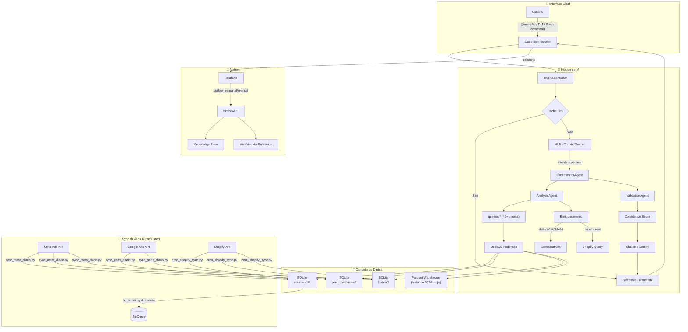
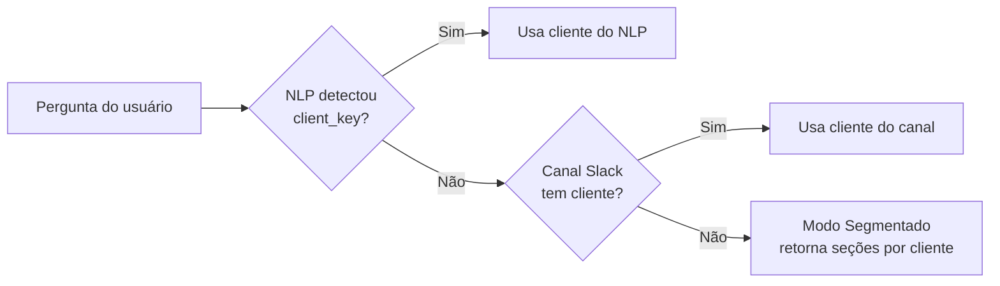
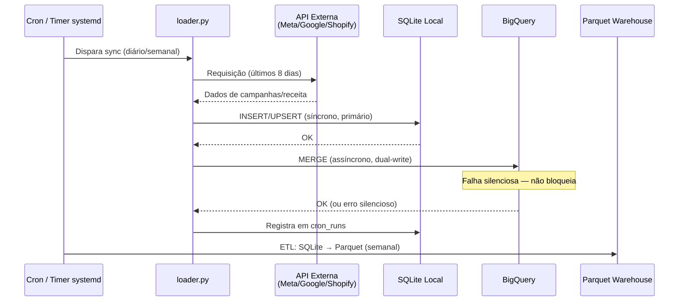
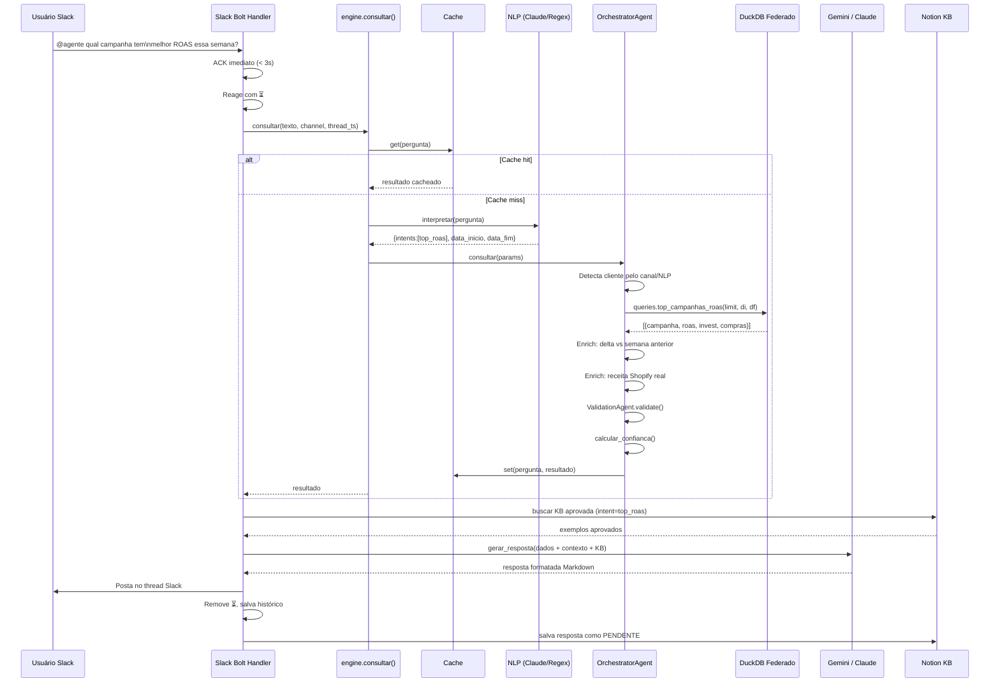
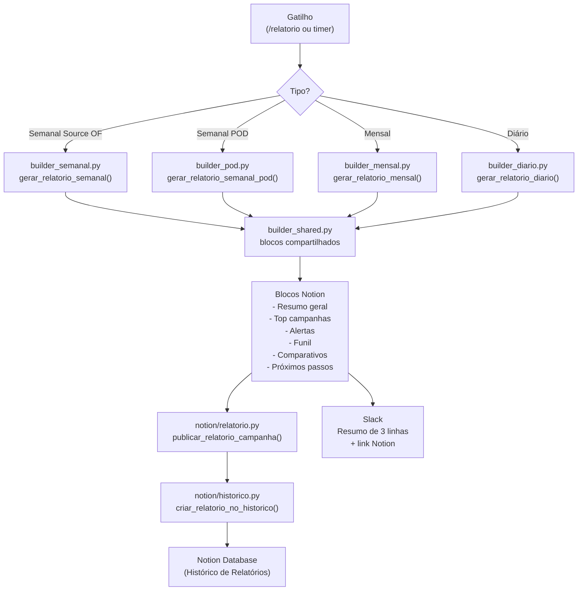
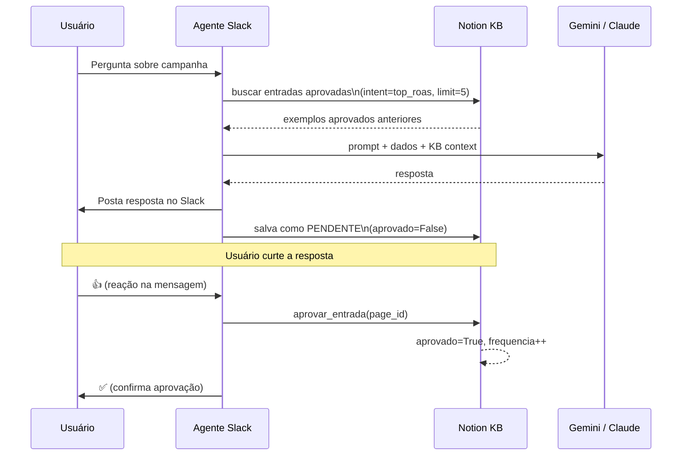
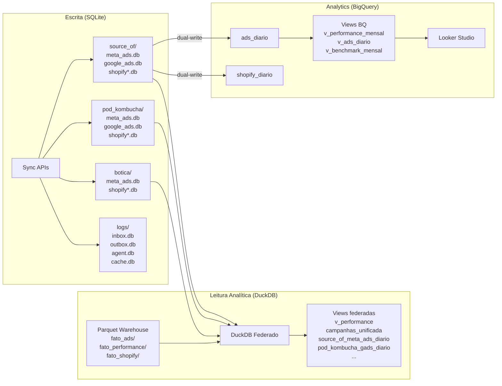

PLACEHOLDER_CONTENT   

> Agente de IA para análise de performance de campanhas de marketing digital.
> Responde perguntas em linguagem natural via Slack, sincroniza dados de Meta Ads, Google Ads e Shopify, e publica relatórios automáticos no Notion.

**Servidor:** AWS EC2 `44.204.251.251` · **Porta:** `8001` · **Serviço:** `agente-guara.service`

---

## 📋 Índice

1. [Visão Geral](#-visão-geral)
2. [Arquitetura do Sistema](#-arquitetura-do-sistema)
3. [Clientes Atendidos](#-clientes-atendidos)
4. [Subagentes de IA](#-subagentes-de-ia)
5. [Fluxo de Dados (Sync)](#-fluxo-de-dados-sync)
6. [Fluxo de Consulta (Slack → Resposta)](#-fluxo-de-consulta-slack--resposta)
7. [Interface Slack](#-interface-slack)
8. [Módulo de Relatórios](#-módulo-de-relatórios)
9. [Base de Conhecimento (Notion KB)](#-base-de-conhecimento-notion-kb)
10. [Banco de Dados e Warehouse](#-banco-de-dados-e-warehouse)
11. [API REST](#-api-rest)
12. [Serviços Systemd e Crons](#️-serviços-systemd-e-crons)
13. [Estrutura de Diretórios](#-estrutura-de-diretórios)
14. [Variáveis de Ambiente](#-variáveis-de-ambiente)
15. [Como Rodar Localmente](#-como-rodar-localmente)
16. [Testes](#-testes)

---

## 🎯 Visão Geral

O **Agente de Performance Guará** é um sistema de análise de marketing digital com IA, desenvolvido pela Guará Marketing para atender múltiplos clientes. O agente:

- **Responde perguntas em linguagem natural** via Slack (ex: *"qual campanha teve melhor ROAS essa semana?"*)
- **Sincroniza automaticamente** dados de Meta Ads, Google Ads e Shopify via APIs
- **Gera relatórios** diários, semanais e mensais publicados no Notion
- **Detecta automaticamente** o cliente pelo canal do Slack ou pelo contexto da pergunta
- **Armazena histórico** em SQLite local + espelha no BigQuery para dashboards (Looker Studio)

### Stack Tecnológica

| Camada | Tecnologia |
|--------|-----------|
| API / Servidor | FastAPI + Uvicorn (Python 3.12) |
| Interface Slack | Slack Bolt (async) |
| LLM Principal | Google Gemini (`GEMINI_API_KEY`) |
| LLM Fallback | Anthropic Claude Haiku 4.5 |
| Banco Operacional | SQLite (por cliente/plataforma) |
| Motor Analítico | DuckDB + Parquet (warehouse local) |
| Espelho Analítico | BigQuery (Google Cloud) |
| Relatórios | Notion API |
| Infraestrutura | AWS EC2 Ubuntu + systemd |

---

## 🏗️ Arquitetura do Sistema



---

## 👥 Clientes Atendidos

O sistema atende múltiplos clientes, configurados em `clientes.json`. Cada cliente tem suas próprias contas de API, tabelas SQLite isoladas e prompts personalizados.

| Emoji | Cliente | Meta Ads | Google Ads | Shopify | Relatório |
|-------|---------|----------|-----------|---------|-----------|
| 🔵 | **Source OF** | ✅ `act_1059884...` | ✅ `4311260590` | ✅ | Diário + Semanal + Mensal |
| 🟢 | **POD Kombucha** | ✅ `act_324906...` | ✅ `6123672195` | ✅ | Semanal + Mensal |
| 🟠 | **Botica Ouro Preto** | ✅ `act_512078...` | ❌ | ✅ | Semanal + Mensal |

### Detecção automática de cliente



---

## 🤖 Subagentes de IA

O sistema é composto por múltiplos agentes especializados que se comunicam em cadeia:

### Diagrama de Agentes

```mermaid
graph TD
    subgraph ENTRADA["Entrada"]
        SLACK_MSG[Mensagem Slack] --> ENGINE["engine.consultar()"]
    end

    subgraph ORQUESTRADOR["1️⃣ OrchestratorAgent\nagent/orchestrator/agent.py"]
        ENGINE --> OA_CACHE{Cache?}
        OA_CACHE -->|Hit| OA_RET[Retorna cache]
        OA_CACHE -->|Miss| OA_NLP[Chama NLP]
        OA_NLP --> OA_DET[Detecta cliente/plataforma]
        OA_DET --> OA_DELEGA[Delega para AnalysisAgent]
        OA_DELEGA --> OA_ENRICH[Enriquece resultado]
        OA_ENRICH --> OA_CONF[Calcula Confidence Score]
        OA_CONF --> OA_CACHE_W[Salva cache]
    end

    subgraph NLP_AGENT["2️⃣ NLP Agent\nagent/nlp.py"]
        OA_NLP --> NLP_PROMPT[Monta prompt com few-shots]
        NLP_PROMPT --> LLM_NLP[Claude / Gemini]
        LLM_NLP --> NLP_PARSE[Parseia JSON]
        NLP_PARSE -->|"intents[]"| NLP_OUT1[Intenções]
        NLP_PARSE -->|"campanha"| NLP_OUT2[Campanha]
        NLP_PARSE -->|"data_inicio/fim"| NLP_OUT3[Período]
        NLP_PARSE -->|"cliente_key"| NLP_OUT4[Cliente]
    end

    subgraph ANALYSIS["3️⃣ AnalysisAgent\nagent/analysis_agent.py"]
        OA_DELEGA --> AA_MAP[Mapeia intent → query]
        AA_MAP --> AA_EXEC["queries/*.py\n(40+ funções)"]
        AA_EXEC --> AA_DELTA[Enrich: Delta WoW/MoM]
        AA_DELTA --> AA_SHOP[Enrich: Shopify real revenue]
        AA_SHOP --> AA_SQL{Dados vazios?}
        AA_SQL -->|"Sim"| AA_DYNASQL[SQL Dinâmico\nsql_generator.py]
        AA_SQL -->|"Não"| AA_RET[Retorna dados]
        AA_DYNASQL --> AA_RET
    end

    subgraph VALIDATION["4️⃣ ValidationAgent\nagent/validation_agent.py"]
        OA_ENRICH --> VA_CHECK[Verifica sanidade\n(zero LLM)]
        VA_CHECK --> VA_ERROS{Erros?}
        VA_ERROS -->|"Sim"| VA_WARN[Injeta avisos no meta]
        VA_ERROS -->|"Não"| VA_OK[OK]
    end

    subgraph LLM_RESP["5️⃣ LLM Client\nagent/claude_client.py"]
        OA_CONF --> LLM_PRIM{Gemini\ndisponível?}
        LLM_PRIM -->|"Sim"| GEMINI[Google Gemini]
        LLM_PRIM -->|"Não"| CLAUDE[Claude Haiku 4.5]
        GEMINI --> LLM_FORMAT[Formata resposta\nem Markdown/Slack]
        CLAUDE --> LLM_FORMAT
    end
```

### Descrição detalhada de cada agente

#### 1. OrchestratorAgent (`agent/orchestrator/agent.py`)
Agente orquestrador principal, ativado quando `MULTI_AGENT=1`. Coordena todo o fluxo:
- Recebe a pergunta em linguagem natural
- Verifica cache (retorno imediato se hit)
- Aciona o NLP para extrair intents, campanha, datas e cliente
- Detecta o cliente via: NLP > canal Slack > modo segmentado
- Delega para o `AnalysisAgent` executar as queries
- Enriquece o resultado com delta (período anterior) e dados Shopify
- Calcula score de confiança da resposta
- Salva resultado no cache e atualiza preferências do usuário

#### 2. AnalysisAgent (`agent/analysis_agent.py`)
Agente executor de análises. Mapeia **40+ intents** para funções SQL específicas:
- `resumo_geral` → `queries.resumo_por_campanha()`
- `top_roas` → `queries.top_campanhas_roas()`
- `alertas_roas` → `queries.alertas_roas_baixo()`
- `funil` → `queries.metricas_funil()`
- `evolucao_diaria` → `queries.evolucao_diaria()`
- `comparar` → `comparar_campanhas_detalhado()`
- `projecao_mes` → `queries.projecao_fechamento_mes()`
- ... e mais 30+ intents mapeados

Também executa **SQL dinâmico** via `sql_generator.py` para perguntas ad-hoc com filtros numéricos.

#### 3. ValidationAgent (`agent/validation_agent.py`)
Validação de sanidade dos dados **sem uso de LLM** (custo zero):
- Verifica se os dados fazem sentido (ROAS negativo, datas inválidas, etc.)
- Retorna lista de erros e avisos
- Injeta metadados de validação no prompt para o Claude/Gemini ter contexto

#### 4. NLP (`agent/nlp.py`)
Motor de interpretação de linguagem natural:
- **Primary:** Claude Haiku via Anthropic API
- **Fallback local:** regex + sinônimos (`synonyms.py`)
- Usa **few-shot examples** no prompt para maior precisão
- Cache de resultados NLP por pergunta normalizada
- Retry automático em caso de JSON inválido (até 2 tentativas)
- Extrai: `intents[]`, `campanha`, `data_inicio`, `data_fim`, `cliente_key`, `plataforma`, `limit`

#### 5. LLM Client (`agent/claude_client.py`)
Cliente unificado para geração de respostas:
- **Primary:** Google Gemini (`GEMINI_API_KEY`) — mais barato
- **Fallback:** Anthropic Claude Haiku 4.5 (`ANTHROPIC_API_KEY`)
- Função `gerar_resposta()` monta o prompt com dados brutos + contexto da thread + KB aprovada
- Resposta formatada em Markdown compatível com Slack Blocks

---

## 🔄 Fluxo de Dados (Sync)

Os dados são coletados automaticamente das APIs e armazenados em SQLite local. Um mecanismo de **dual-write** espelha os dados no BigQuery em paralelo.



### Estratégia de Merge no BigQuery

Para evitar duplicatas (o sync roda a cada ciclo), o BigQuery usa **MERGE (upsert)**:

| Plataforma | Chave de Merge |
|-----------|----------------|
| Meta Ads | `cliente + plataforma + data + campaign_id + adset_id + ad_id` |
| Google Ads | `cliente + plataforma + data + campaign_id` |
| Shopify | `cliente + data` |

> **Por que chaves diferentes?** O Meta Ads rastreia no nível de anúncio individual (`ad_id`). O Google Ads reporta no nível de campanha — `ad_id` e `adset_id` chegam como `NULL`, e `NULL = NULL` retorna `FALSE` em SQL.

### Frequência de Sync

| Fonte | Script | Frequência | Janela |
|-------|--------|-----------|--------|
| Meta Ads | `sync_meta_diario.py` | Diário (timer) | Últimos 8 dias |
| Google Ads | `sync_gads_diario.py` | Diário (timer) | Últimos 8 dias |
| Shopify (Source OF) | `cron_shopify_sync.py` | Diário às 09h30 BRT | Últimos 8 dias |
| Shopify (POD / Botica) | `cron_shopify_sync.py` | Diário às 09h30 BRT | Últimos 8 dias |
| Meta Ads (totais semanais) | `sync_meta_semanal.py` | Segunda 06h BRT | Semana anterior |
| ETL Warehouse | `etl_warehouse.py` | Semanal | Mês corrente |

---

## 💬 Fluxo de Consulta (Slack → Resposta)



---

## 🔧 Interface Slack

### Slash Commands

| Comando | Descrição | Exemplo |
|---------|-----------|---------|
| `/hoje` | Resumo do dia atual | `/hoje` |
| `/semana` | Resumo dos últimos 7 dias | `/semana` |
| `/mes [período]` | Resumo mensal | `/mes junho` · `/mes 2026-05` |
| `/top [n] [roas\|compras]` | Top campanhas por métrica | `/top 5 roas` · `/top 3 compras` |
| `/campanha <nome>` | Performance de uma campanha | `/campanha ABO` |
| `/alertas` | Campanhas com ROAS ruim | `/alertas` |
| `/funil [campanha]` | Funil de conversão | `/funil` · `/funil Advantage` |
| `/compare <A> vs <B>` | Comparação entre campanhas | `/compare ABO vs Advantage` |
| `/relatorio [opts]` | Gera e publica no Notion | `/relatorio` · `/relatorio pod` · `/relatorio mes` |
| `/pod [arg]` | Consultas POD Kombucha | `/pod status` · `/pod essa semana` |
| `/campanhas` | Lista todas as campanhas | `/campanhas` |
| `/status` | Status do sistema | `/status` |
| `/kb` | Base de conhecimento | `/kb` |
| `/exemplos` | Exemplos de perguntas | `/exemplos` |
| `/metricas` | Métricas disponíveis | `/metricas` |
| `/cache-limpar` | Limpa cache de respostas | `/cache-limpar` |
| `/ajuda` | Ajuda geral | `/ajuda` |

### Perguntas em linguagem natural

O agente entende perguntas naturais em português via `@menção` ou DM:

```
@agente qual campanha teve melhor ROAS essa semana?
@agente compara ABO vs Advantage em junho
@agente tem alguma campanha gastando sem converter?
@agente gera relatório semanal em Excel e Notion
@agente projeção de fechamento do mês
@agente top 5 por compras no mês passado
```

### Eventos Slack

| Evento | Handler | Ação |
|--------|---------|------|
| `app_mention` | `handle_mention` | Processa @menção, detecta exportação, responde no thread |
| `message` (DM) | `handle_dm` | Processa DM, mesmo fluxo da menção |
| `reaction_added` (👍) | `handle_reaction` | Aprova entrada na Knowledge Base |

---

## 📊 Módulo de Relatórios

O sistema gera relatórios automáticos e publica no Notion. Os relatórios são disparados por slash command ou por timers systemd.



### Estrutura de um relatório Semanal

| Seção | Conteúdo |
|-------|---------|
| 📋 Resumo Geral | Investimento, Receita, ROAS, Compras totais |
| 🏆 Top Campanhas | Ranking por ROAS e por compras |
| 🚨 Alertas | Campanhas com ROAS abaixo do mínimo |
| 🔻 Funil | Impressões → Cliques → Carrinho → Compra |
| 📈 Comparativo | Semana atual vs semana anterior (delta %) |
| 🛒 Shopify | Receita real, ROAS real, ticket médio, recompra |
| 📅 Visão Diária | Breakdown dia a dia da semana |
| 🎯 Próximos Passos | Recomendações geradas pelo LLM |

---

## 🧠 Base de Conhecimento (Notion KB)

O agente aprende com o tempo através de um sistema de aprovação por reação no Slack.



**Database Notion:** `3888a727-a8ff-8163-9753-f7579b8a0bbe`

Cada entrada da KB contém:
- `intent` — tipo de consulta
- `pergunta` — pergunta original do usuário
- `resposta` — resposta gerada pelo bot
- `aprovado` — `True/False`
- `frequencia` — quantas vezes foi aprovado
- `slack_ts` — timestamp da mensagem Slack

---

## 🗄️ Banco de Dados e Warehouse

### Arquitetura em Duas Camadas



### Warehouse Local (Parquet + DuckDB)

| Tabela | Conteúdo | Partição |
|--------|---------|---------|
| `fato_performance/` | Performance consolidada por campanha/dia | Mensal |
| `fato_ads/` | Dados brutos de anúncios Meta + Google | Mensal |
| `fato_shopify/` | Receita Shopify por cliente/dia | Mensal |
| `dim_cliente` | Cadastro de clientes | Estático |
| `dim_campanha` | Cadastro de campanhas | Cresce devagar |
| `dim_tempo` | Calendário 2024–2030 | Pré-calculado |

**Histórico disponível:** 2024-01 até o mês corrente

### SQLite Operacional

Cada cliente tem bancos isolados em `data/performance/{cliente}/`:

```
data/performance/
├── source_of/
│   ├── meta_ads.db          # Campanhas Meta Ads Source OF
│   ├── google_ads.db        # Campanhas Google Ads Source OF
│   ├── shopify.db           # Sessões Shopify Source OF
│   └── shopify_receita.db   # Receita diária Shopify Source OF
├── pod_kombucha/
│   ├── meta_ads.db
│   ├── google_ads.db
│   ├── gads.db
│   └── shopify_receita.db
└── botica/
    ├── meta_ads.db
    └── shopify_receita.db
```

---

## 🌐 API REST

Além da interface Slack, o agente expõe uma API REST:

| Método | Endpoint | Descrição |
|--------|----------|-----------|
| GET | `/health` | Health check do serviço |
| POST | `/slack/events` | Webhook Slack Bolt |
| GET | `/campanhas` | Lista todas as campanhas |
| POST | `/consulta` | Consulta em linguagem natural |
| POST | `/sql` | Executa SQL (apenas SELECT) |
| GET | `/resumo` | Resumo geral |
| GET | `/top/roas` | Top campanhas por ROAS |
| GET | `/top/compras` | Top campanhas por compras |
| GET | `/campanha/{nome}` | Performance de campanha |
| GET | `/campanha/{nome}/funil` | Funil de conversão |
| GET | `/alertas/roas` | Alertas de ROAS baixo |
| GET | `/evolucao` | Evolução diária |
| POST | `/db/reload` | Recarrega conexão do banco |
| GET | `/shopify/status` | Status sync Shopify |
| POST | `/shopify/sync` | Dispara sync Shopify manual |
| GET | `/shopify/receita` | Receita Shopify |
| GET | `/shopify/diario` | Receita Shopify por dia |

---

## ⚙️ Serviços Systemd e Crons

### Serviços em execução

| Serviço | Tipo | Status | Função |
|---------|------|--------|--------|
| `agente-guara.service` | service | ✅ running | FastAPI na porta 8001 |
| `guara-relatorio-diario.timer` | timer | ✅ waiting | Dispara relatório diário 12h30 UTC |
| `guara-relatorio-diario.service` | service | ⚠️ failed | Executa `cron_relatorio.py` |
| `guara-shopify-sessions.timer` | timer | ✅ waiting | Sync sessões Shopify 12h30 UTC |
| `guara-meta-semanal.timer` | timer | ✅ waiting | Sync Meta semanal (segunda 09h UTC) |
| `guara-relatorio-semanal.service` | service | ⚠️ failed | Relatório semanal Notion |
| `guara-api.service` | service | ✅ running | Guará API auxiliar |
| `rptn-sync.service` | service | ✅ running | Reportana Shopify sync |

### Crons (`crontab -l`)

| Horário | Script | Função |
|---------|--------|--------|
| `30 11 * * *` | `run_relatorio_pod.sh` | Relatório POD Kombucha (08h30 BRT) |
| `30 19 * * *` | `run_relatorio_pod.sh` | Relatório POD Kombucha (16h30 BRT) |

### Fluxo de timers

```mermaid
gantt
    title Agenda diária de jobs (UTC)
    dateFormat HH:mm
    axisFormat %H:%M

    section Meta Ads
    Sync Meta diário         :06:00, 30m

    section Shopify
    Sync Shopify + Sessões   :12:30, 20m

    section Relatórios
    Relatório Diário Slack   :12:30, 15m
    Relatório POD (manhã)    :11:30, 10m
    Relatório POD (tarde)    :19:30, 10m

    section Backup
    Backup DB (Flora)        :00:00, 5m
```



---

## 📁 Estrutura de Diretórios

```
agente-performance/
│
├── main.py                         # Entrypoint FastAPI — porta 8001
├── clientes.json                   # Registry de clientes e configurações de API
├── requirements.txt                # Dependências Python
├── .env                            # Variáveis de ambiente (secrets)
├── .env.example                    # Template de variáveis
│
├── agent/                          # 🤖 Núcleo de IA
│   ├── engine.py                   # Motor principal: NLP → query → resultado
│   ├── orchestrator/
│   │   └── agent.py                # OrchestratorAgent (MULTI_AGENT=1)
│   ├── analysis_agent.py           # AnalysisAgent: 40+ intents mapeados
│   ├── base_agent.py               # Interface base para agentes
│   ├── nlp.py                      # NLP: interpreta pergunta → parâmetros
│   ├── claude_client.py            # Cliente LLM: Gemini (primary) + Claude (fallback)
│   ├── cache.py                    # Cache in-memory de respostas
│   ├── context_store.py            # Histórico de threads Slack
│   ├── conversation_log.py         # Log de conversas
│   ├── comparatives.py             # Comparativos WoW, MoM, YoY, antes/depois
│   ├── confidence.py               # Score de confiança de respostas
│   ├── validation_agent.py         # Validação de sanidade (zero LLM)
│   ├── sql_generator.py            # SQL dinâmico para queries ad-hoc
│   ├── sql_validator.py            # Valida SQL antes de executar
│   ├── registry.py                 # Registry de segmentos ativos
│   ├── synonyms.py                 # Sinônimos de períodos (português)
│   ├── user_prefs.py               # Preferências por usuário Slack
│   ├── tz.py                       # Timezone BRT (UTC-3)
│   ├── queries/                    # Módulos de queries SQL por domínio
│   │   ├── resumo.py               # Resumos gerais e por campanha
│   │   ├── alertas.py              # Alertas de ROAS baixo e sem conversão
│   │   ├── criativos.py            # Performance de criativos
│   │   ├── comparativos.py         # Comparações de período e plataforma
│   │   ├── evolucao.py             # Evolução diária
│   │   ├── ranking.py              # Rankings por métricas
│   │   ├── shopify.py              # Receita Shopify e ROAS real
│   │   ├── source_of/              # Queries específicas Source OF
│   │   ├── pod_kombucha/           # Queries específicas POD Kombucha
│   │   └── botica/                 # Queries específicas Botica
│   └── clients/                    # Agentes especializados por cliente
│       ├── base.py
│       ├── source_of.py
│       ├── pod.py
│       ├── botica.py
│       └── relatorio/              # Builders de relatório por cliente
│
├── slack/                          # 💬 Interface Slack
│   ├── handlers.py                 # Slash commands + eventos app_mention/DM/reaction
│   ├── responder.py                # _processar_e_responder(): núcleo de resposta
│   ├── formatter.py                # Markdown → Slack Blocks
│   ├── poster.py                   # Posta mensagens formatadas
│   └── helpers.py                  # Utilitários, constantes, AJUDA_TEXTO
│
├── api/                            # 🌐 REST API
│   ├── app.py                      # Endpoints FastAPI
│   └── relatorio_history.py        # Histórico de relatórios via API
│
├── db/                             # 🗄️ Camada de dados
│   ├── connections.py              # Conexões federadas DuckDB (multi-SQLite)
│   ├── schema.py                   # DDL — criação de tabelas
│   ├── duck.py                     # Helpers DuckDB
│   ├── shopify_sync.py             # Alias para shopify/sync.py
│   ├── bq_writer.py                # Dual-write para BigQuery
│   ├── registry.py                 # Registry de DBs por cliente/plataforma
│   ├── consultas_log.py            # Log de consultas Slack
│   ├── relatorio_log.py            # Log de relatórios publicados
│   ├── cron_log.py                 # Log de execuções de cron
│   ├── sync_alerts.py              # Alertas de sync com falha
│   ├── slack_log.py                # Log de mensagens Slack
│   └── views.sql                   # Views DuckDB federadas
│
├── meta_ads/                       # 🔵 Meta Ads API
│   └── loader.py                   # Coleta e salva dados Meta Ads
│
├── google_ads/                     # 🔴 Google Ads API
│   ├── client.py                   # Cliente Google Ads API
│   └── loader.py                   # Coleta e salva dados Google Ads
│
├── shopify/                        # 🛒 Shopify API
│   ├── client.py                   # Cliente Shopify base
│   ├── sync.py                     # Sync Source OF
│   ├── sync_pod.py                 # Sync POD Kombucha
│   ├── sync_botica.py              # Sync Botica Ouro Preto
│   └── abandoned_checkouts.py      # Carrinhos abandonados
│
├── notion/                         # 📓 Notion API
│   ├── client.py                   # Cliente Notion API
│   ├── relatorio.py                # Publica relatórios como páginas Notion
│   ├── knowledge_base.py           # Knowledge Base — memória de longo prazo
│   ├── historico.py                # Histórico de relatórios publicados
│   └── blocks.py                   # Helpers para blocos Notion
│
├── relatorio/                      # 📊 Builders de Relatório
│   ├── builder_diario.py           # Relatório diário
│   ├── builder_semanal.py          # Relatório semanal Source OF
│   ├── builder_mensal.py           # Relatório mensal Source OF
│   ├── builder_pod.py              # Relatório POD Kombucha
│   ├── builder_shared.py           # Blocos compartilhados entre builders
│   ├── insights.py                 # Geração de insights via LLM
│   ├── regras.py                   # Regras de negócio (impostos, ROAS mínimo)
│   └── shared/                     # Formatadores e analytics compartilhados
│
├── clientes/                       # 🏢 Configs e prompts por cliente
│   ├── source_of/
│   │   ├── config.json             # Config Source OF
│   │   ├── prompts.py              # System prompts personalizados
│   │   └── relatorio/              # Relatórios específicos
│   ├── pod/
│   │   ├── config.json
│   │   ├── prompts.py
│   │   └── relatorio/
│   └── botica/
│       ├── config.json
│       └── prompts.py
│
├── scripts/                        # 🔄 Scripts de sync e automação
│   ├── sync_meta_diario.py         # Meta Ads → SQLite (todos os clientes)
│   ├── sync_gads_diario.py         # Google Ads → SQLite (todos os clientes)
│   ├── sync_meta_semanal.py        # Sync semanal Meta (campaign_totals)
│   ├── cron_shopify_sync.py        # Shopify → SQLite + BigQuery
│   ├── cron_relatorio.py           # Gera relatório e posta no Slack
│   ├── cron_todos_relatorios.py    # Dispara todos os relatórios
│   ├── etl_warehouse.py            # ETL: SQLite → Parquet warehouse
│   ├── dashboard_ingest.py         # Ingest para dashboard
│   ├── backup_db.sh                # Backup dos bancos SQLite
│   ├── source_of/
│   │   ├── cron.py                 # Cron específico Source OF
│   │   └── relatorio_diario.py     # Relatório diário Source OF
│   └── pod/
│       ├── cron.py                 # Cron específico POD
│       └── relatorio_diario.py     # Relatório diário POD
│
├── data/                           # 💾 Dados locais
│   ├── performance/                # SQLite por cliente/plataforma
│   │   ├── source_of/
│   │   ├── pod_kombucha/
│   │   └── botica/
│   ├── warehouse/                  # Parquet + DuckDB (histórico)
│   │   ├── SCHEMA.md
│   │   ├── dim_*.parquet
│   │   ├── fato_ads/               # Particionado por mês (2024-01 → atual)
│   │   ├── fato_performance/       # Particionado por mês
│   │   └── fato_shopify/           # Particionado por mês
│   ├── logs/                       # Logs operacionais
│   ├── backups/                    # Backups automáticos (a cada 3 dias)
│   └── exports/                    # CSVs exportados
│
├── alteracoes/                     # 📝 Log de alterações significativas
│   └── YYYY-MM-DD_slug.md
│
├── docs/                           # 📚 Documentação técnica
│   ├── ARQUITETURA_DADOS.md
│   ├── BIGQUERY.md
│   ├── DATA_WAREHOUSE.md
│   └── ...
│
└── tests/                          # 🧪 Testes
    ├── test_consultas.py
    ├── test_metricas.py
    ├── test_engine_validacao.py
    ├── test_duck_connection.py
    └── test_infraestrutura.py
```

---

## 🔐 Variáveis de Ambiente

Crie o arquivo `.env` na raiz do projeto (veja `.env.example`):

| Variável | Obrigatório | Descrição |
|----------|-------------|-----------|
| `SLACK_BOT_TOKEN` | ✅ | Token do bot Slack (`xoxb-...`) |
| `SLACK_SIGNING_SECRET` | ✅ | Signing secret do app Slack |
| `ANTHROPIC_API_KEY` | ✅ | Chave da API Anthropic (Claude) |
| `GEMINI_API_KEY` | ✅ | Chave da API Google Gemini (LLM primário) |
| `NOTION_API_KEY` | ✅ | Integration token do Notion |
| `META_ACCESS_TOKEN` | ✅ | Token de acesso Meta Ads (Source OF) |
| `META_ACCOUNT_ID` | ✅ | ID da conta Meta Ads Source OF |
| `META_POD_ACCESS_TOKEN` | ✅ | Token Meta Ads POD Kombucha |
| `META_BOTICA_ACCESS_TOKEN` | ✅ | Token Meta Ads Botica |
| `GOOGLE_ADS_DEVELOPER_TOKEN` | ✅ | Token de desenvolvedor Google Ads |
| `GOOGLE_ADS_CLIENT_ID` | ✅ | OAuth Client ID Google Ads |
| `GOOGLE_ADS_CLIENT_SECRET` | ✅ | OAuth Client Secret Google Ads |
| `GOOGLE_ADS_REFRESH_TOKEN` | ✅ | OAuth Refresh Token Google Ads |
| `SHOPIFY_ACCESS_TOKEN` | ✅ | Token Shopify Source OF |
| `SHOPIFY_POD_TOKEN` | ✅ | Token Shopify POD Kombucha |
| `SHOPIFY_BOTICA_TOKEN` | ✅ | Token Shopify Botica |
| `CLAUDE_MODEL` | ➖ | Modelo Claude (default: `claude-haiku-4-5-20251001`) |
| `MULTI_AGENT` | ➖ | Ativa OrchestratorAgent (`1` ou `0`, default: `0`) |
| `LOG_LEVEL` | ➖ | Nível de log (default: `INFO`) |
| `PORT` | ➖ | Porta do servidor (default: `8001`) |
| `SLACK_HANDLER_TIMEOUT` | ➖ | Timeout handler Slack em segundos (default: `60`) |
| `GOOGLE_APPLICATION_CREDENTIALS` | ➖ | Path do service account JSON (BigQuery) |

---

## Testes

```
python -m pytest tests/ -v
python -m pytest tests/test_consultas.py -v
python -m pytest tests/test_metricas.py -v
```

---

## Licença

Projeto privado — Guará Marketing. Todos os direitos reservados.

---

*Documentação gerada em 2026-10-19 — Cesar (Agente de Performance)*
