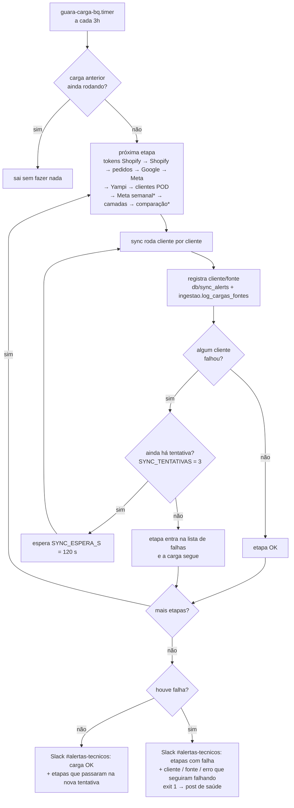

# Carga do BigQuery na VM: fluxo, nova tentativa e alerta

`guara-carga-bq.timer` roda `scripts/cron_master_sync.sh` a cada 3h (02:10 UTC + 3h).

\* Meta semanal só na segunda; comparação BigQuery × API uma vez por semana.

## Regras

- **Nova tentativa:** a etapa inteira é refeita quando qualquer cliente falha (todos os syncs saem com código 1 nesse caso).
- **Fonte por etapa:** `shopify`, `pedidos`, `google`, `meta`, `yampi` (por loja), `shopify_clientes`.
- **Alerta por cliente e fonte:** dentro da carga o `sync_alerts` não posta (`SYNC_ALERT_SLACK=0`); o aviso sai um só, no fim, listando quem seguiu em erro depois das tentativas. Rodando um sync avulso, o `sync_alerts` avisa sozinho (2 falhas seguidas, 1h de intervalo).
- **Teste:** `tests/test_carga_falha.py` roda o script de verdade com syncs falsos (um cliente sempre falha, outro só na 1ª tentativa) e confere a nova tentativa e o texto do aviso.
