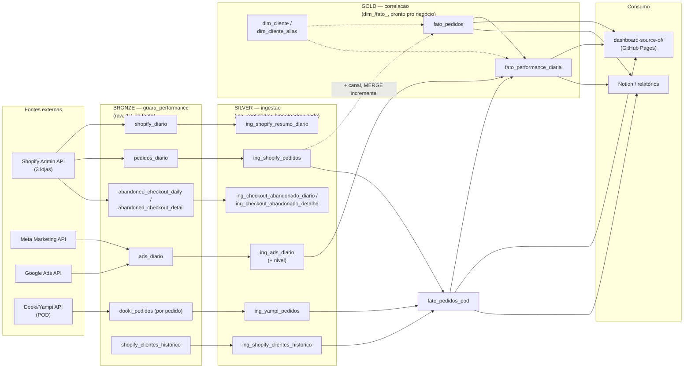

# Arquitetura Medallion — guara-db

Modelada sobre [DataWithBaraa/sql-data-warehouse-project](https://github.com/DataWithBaraa/sql-data-warehouse-project),
adaptada de SQL Server (CSV + BULK INSERT) para BigQuery (APIs + dual-write
Python, stored procedures nativas do BigQuery).

## As três camadas

**Bronze (`guara_performance`)** — espelho bruto de cada fonte, sem
transformação. Gravado em dual-write pelos scripts de sync
(`cron_shopify_sync.py`, `sync_pedidos_diario.py`, `sync_gads_diario.py`,
`sync_meta_diario.py`) via `db/bq_writer.py`, rodando a cada 6h pelo
`scripts/cron_master_sync.sh`. Serve como trilha de auditoria: se um
cálculo do gold parecer errado, o primeiro lugar a conferir é aqui.

**Silver (`ingestao`)** — uma tabela `ing_<entidade>` por entidade do
bronze, **limpa** e carregada por MERGE idempotente pela chave natural
(`ingestao.sp_upsert`, chamada por `ingestao.load_silver()`,
`bigquery/scripts/silver/proc_load_silver.sql`). A silver nunca é recriada:
insere o novo, atualiza só o que mudou, remove o que saiu do bronze; rodar
duas vezes seguidas não altera nada. Fonte vazia aborta a carga em vez de
apagar a tabela. Cada carga grava uma linha por tabela em
`ingestao.log_cargas`. As tabelas que a procedure só alimenta têm o DDL em
`bigquery/scripts/silver/ddl_silver.sql`.

Regras de limpeza (vivem na silver, não no gold):
- texto: `trim`; e-mail, `utm_source` e `utm_medium` em minúsculas; vazio vira NULL;
- `ing_ads_diario`: `nivel` derivado; `cliques_todos` menor que `cliques_link`
  (a fonte não coletou) vira NULL e a linha fica marcada em
  `dq_cliques_todos_ausente`;
- `ing_yampi_pedidos`: as 3 lojas Yampi (poddi, pod-kombucha, pod8), sem o
  `novo_cliente` do bronze (a regra de cliente novo é do gold);
- `ing_shopify_clientes_historico`: primeiro pedido por cliente (cliente novo);
- `ing_tickets`: um ticket por `ticket_id`, a versão mais recente.

**Gold (`correlacao`)** — fatos e dimensões prontos para consumo:
`dim_cliente`/`dim_cliente_alias` (cadastro estático de clientes e seus
aliases de UTM/source), `fato_pedidos` (pedidos pagos + canal derivado,
MERGE incremental — nunca sobrescreve histórico), `fato_performance_diaria`
(investimento + receita + ROAS por cliente/canal/dia, full rebuild).
Reconstruída pela stored procedure `correlacao.load_gold()`
(`bigquery/scripts/gold/proc_load_gold.sql`).

**O gold lê somente a silver**, nunca o bronze. `scripts/rebuild_bq_layers.py`
só dispara as duas procedures, nessa ordem (silver antes de gold). É o último passo de `scripts/cron_master_sync.sh`.

## Fora do escopo desta camada

`correlacao.fato_tickets`, `correlacao.alertas_qualidade_dados` e
`correlacao.qualidade_dados_checks` pertencem ao subsistema de SLA de tickets
(agente de transcrição — `MetricasAgent`/`TicketAgent`) e não são tocados por
`load_gold`. As tabelas silver `ing_tickets` e `ing_metricas_sla` agora são
alimentadas por `load_silver`, mas só andam quando o bronze (`tickets_alerta`,
`metricas_sla`) recebe carga nova: o bronze de tickets está parado desde 29/10,
por parte do pipeline de transcrição.
