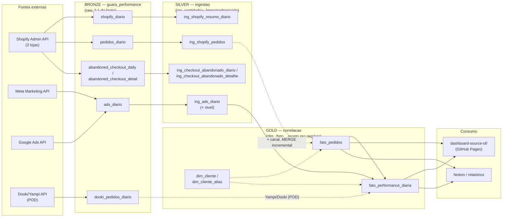

# Arquitetura Medallion — guara-db

Modelada sobre [DataWithBaraa/sql-data-warehouse-project](https://github.com/DataWithBaraa/sql-data-warehouse-project),
adaptada de SQL Server (CSV + BULK INSERT) para BigQuery (APIs + dual-write
Python, stored procedures nativas do BigQuery).

## As três camadas

**Bronze (`guara_performance`)** — espelho bruto de cada fonte, sem
transformação. Gravado em dual-write pelos scripts de sync
(`cron_shopify_sync.py`, `sync_pedidos_diario.py`, `sync_gads_diario.py`,
`sync_meta_diario.py`) via `db/bq_writer.py`, rodando a cada 6h pelo
`scripts/cron_master_sync.sh`. Serve como trilha de auditoria: se um
cálculo do gold parecer errado, o primeiro lugar a conferir é aqui.

**Silver (`ingestao`)** — mesmas entidades do bronze (`ing_<entidade>`),
com limpeza mínima (nesta base: nenhuma mudança de schema, só
rematerialização + a coluna `nivel` derivada em `ing_ads_diario`).
Reconstruída pela stored procedure `ingestao.load_silver()`
(`bigquery/scripts/silver/proc_load_silver.sql`) — full refresh de cada
tabela via `CREATE OR REPLACE TABLE ... AS SELECT`, já que as fontes
bronze são pequenas o suficiente para reprocessar por completo a cada
chamada.

**Gold (`correlacao`)** — fatos e dimensões prontos para consumo:
`dim_cliente`/`dim_cliente_alias` (cadastro estático de clientes e seus
aliases de UTM/source), `fato_pedidos` (pedidos pagos + canal derivado,
MERGE incremental — nunca sobrescreve histórico), `fato_performance_diaria`
(investimento + receita + ROAS por cliente/canal/dia, full rebuild).
Reconstruída pela stored procedure `correlacao.load_gold()`
(`bigquery/scripts/gold/proc_load_gold.sql`).

`scripts/rebuild_bq_layers.py` só dispara as duas procedures, nessa ordem
(silver antes de gold, porque `fato_performance_diaria` lê
`ingestao.ing_ads_diario`). É o último passo de `scripts/cron_master_sync.sh`.

## Fora do escopo desta camada

`ingestao.ing_tickets`, `ingestao.ing_metricas_sla`,
`correlacao.fato_tickets`, `correlacao.alertas_qualidade_dados` e
`correlacao.qualidade_dados_checks` pertencem a um subsistema diferente
(SLA de tickets de suporte, usado pelo agente de transcrição —
`MetricasAgent`/`TicketAgent`), não ao pipeline de performance de mídia
paga. Não são tocados por `load_silver`/`load_gold`.
