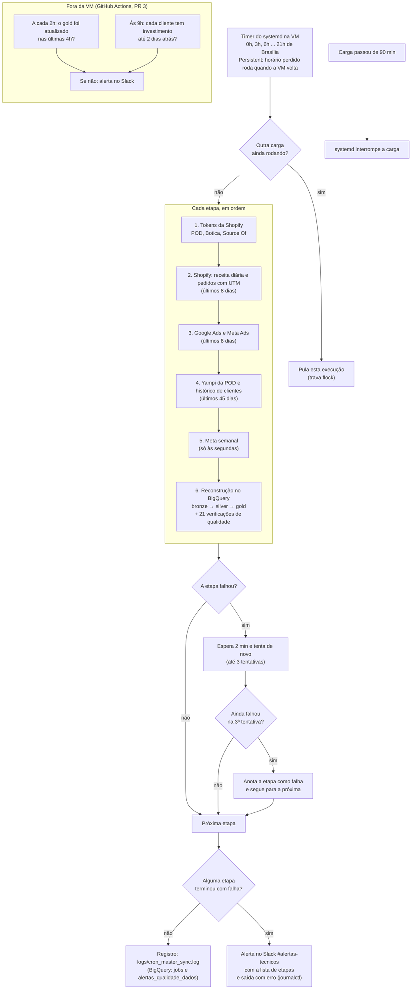

# Fluxograma da carga na VM

Caminho de uma execução da carga do BigQuery na VM Oracle, com nova tentativa e alerta de falha.
O mesmo bloco `mermaid` pode ser colado num bloco de código Mermaid do Notion.

## O que cada parte cobre

| Falha | Quem percebe | Aviso |
|---|---|---|
| Uma etapa falha uma vez (API instável, timeout) | a própria carga | nenhum: a nova tentativa resolve |
| Uma etapa falha 3 vezes | a própria carga | Slack com a etapa que falhou |
| A carga trava | systemd, em 90 min | saída com erro no `journalctl` (e o alerta de frescor, se o gold parar) |
| A VM cai ou o timer para | ninguém na VM | alerta de frescor do GitHub Actions, em até 4h |
| Uma fonte para de mandar dados, mas a carga roda | alerta de frescor das 9h | Slack com o cliente e o último dia com investimento |
| A verificação de qualidade do BigQuery falha | `rebuild_bq_layers.py` | Slack (etapa "Reconstruir camadas" com falha) e `correlacao.alertas_qualidade_dados` |
